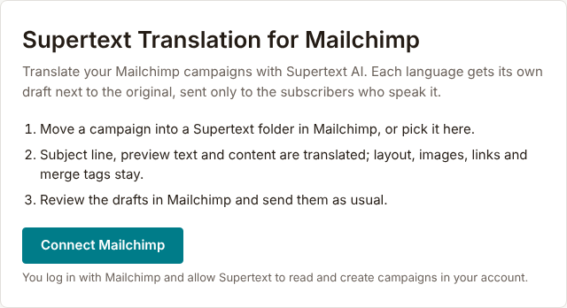

# Installation guide — Supertext Translation for Mailchimp

For Mailchimp account owners and administrators setting up Supertext Translation.

> **Status: in development.** The app is tested against a stand-in of the Mailchimp API. It isn't in the Mailchimp Marketplace yet and hasn't been tried on a real account. Ask Supertext before using it with a live audience.

## How it works

Supertext Translation is an app that runs on Supertext's servers and connects to your Mailchimp account. For each campaign you translate, it makes one **draft per language** in Mailchimp, next to the original: a copy with the subject line, preview text and content translated by Supertext AI, sent only to the subscribers whose language is that language. You review the drafts in Mailchimp and send them as usual.

You start a translation in one of two ways (you choose which in the settings):

- **In Mailchimp:** move a campaign into one of the *Supertext* folders the app creates, for example *Supertext → German*.
- **In the app:** pick the campaign and the languages on the app's *Translate* page.

The app never sends anything to your subscribers and never changes the original's content.

## Requirements

| | |
| --- | --- |
| Mailchimp | Any Mailchimp account. You connect it with a Mailchimp user who can create and edit campaigns (Admin or Manager). |
| Subscriber languages | Mailchimp knows each subscriber's language: it detects it from their browser when they sign up or open an email, or you set it in the audience (field *Language*, or with an import). The translations go to the subscribers with that language. |
| Supertext | An account with an API key, see [step 1](#1-get-a-supertext-account-and-api-key) |

## 1. Get a Supertext account and API key

1. **Account:** no Supertext account yet? [Log in or create one](https://www.supertext.com/person/en/account/signin) with your email address.
2. **API key:** generate it at [supertext.com → Integrations → API](https://www.supertext.com/en/integrations/api). Only users with the **Admin** role in the Supertext account can do this; otherwise ask your Supertext account admin for a key.

The app's settings page links to both, next to the API key field.

## 2. Connect Mailchimp

Open the app (Supertext sends you its address until it is listed in the Mailchimp Marketplace) and click **Connect Mailchimp**. Mailchimp asks you to log in and to allow *Supertext Translation* to access your account; confirm. You come back to the app's settings.

Everyone in your team who connects the same Mailchimp account shares its settings. The connection stays until you disconnect it in the app or remove the app in Mailchimp (Profile → Extras → Connected sites / apps).

## 3. Settings

Enter the API key, choose your languages, give each one its Supertext code and click **Save**. Saving checks the API key automatically (free of charge, nothing is translated) and shows the result under the key: *API key checked: the connection to Supertext works.* means everything is in place. **Test connection** runs the same check again, also for a key you have typed but not saved yet.

| Setting | Default | Purpose |
| --- | --- | --- |
| API key | – | Your Supertext key, with or without the `Supertext-Auth-Key` prefix; stored encrypted. *Remove the saved key* deletes it. |
| Test connection | – | Checks the key (entered or saved) with Supertext, without translating anything. The result of the saved key's check is shown under the key with its time (UTC). |
| Language of your campaigns | English | The language you write your campaigns in. *Let Supertext detect it* works too, but then the app can't leave that language out of the targets. |
| Translate into | none | The languages to translate into. Each one gets a draft per campaign and, with the folder trigger, its own Supertext folder. |
| Supertext code | empty | The language mapping: the code Supertext uses for this Mailchimp language, picked from Supertext's list (the field suggests them). German, English, French, Italian and Portuguese need a region (`de-CH`, `de-DE`, `de-AT`, `en-US`, `en-GB`, `fr-CH`, `fr-FR`, `it-CH`, `it-IT`, `pt-BR`, `pt-PT`), Chinese and Serbian a script (`zh-Hans`, `zh-Hant`, `sr-Latn`, `sr-Cyrl`), Norwegian is `nb`; the others are the bare language (`es`, `nl`, `sl` …). Empty: the Mailchimp code is used only if it is a Supertext code as it is (`es`, `nl`); otherwise the language isn't translated (*has no Supertext code yet*). Nothing is guessed: there are no default regions. The column *Sent to Supertext* shows what each language is sent as, or *Not set*, and the page warns about ticked languages without a code. A code Supertext doesn't offer isn't saved (*Saved, except these codes …*). The same mapping gives the campaign language (`en-US` is sent as the source `en`). |
| Start translations from: Mailchimp folders | On | The app creates the folders *Supertext → All languages* and one per language (*Supertext → German* …) and checks them every minute. Turning it off deletes the empty Supertext folders. |
| Start translations from: The Supertext app | On | The *Translate* page offers the campaigns. At least one of the two stays on. |
| Send the original only to subscribers without a translated language | On | After translating, the original's audience gets "language is not German, not French …" added, so nobody receives two versions. Off: the original keeps its audience. |
| Form of address | Let Supertext decide | *Formal* (German "Sie", French "vous") or *Informal* ("du", "tu"). Sent only for languages where Supertext offers it; the page names the ticked languages that don't have it (English, Swiss German, Romansh, Albanian, Serbian), which are translated with Supertext's default. |
| Send version information to Supertext | On | See *Version information* below. |

The folder names are written in the language of the app's interface at the moment you save the settings (top right: EN, DE, FR, IT).

The settings page also shows the app's version, linked to its release notes.

## Version information

With **Send version information to Supertext** on, the app sends a short report to Supertext's support center (the Commando Center) when you save the settings, on the first visit to the app after connecting, after the app or Node.js was updated, and when the result of the API key check changes (for example a key Supertext rejects during a translation). It contains:

- the Mailchimp account's ID as an address, `https://admin.mailchimp.com/account/<account ID>` (Mailchimp accounts have no website; no account name, login or e-mail address);
- the app's name (`Mailchimp-Supertext-Translation`) and version, `Mailchimp`, and the Node.js and Supertext SDK versions;
- whether an API key is set and the result of the key check (`ok`, `invalid`, `missing`, `unreachable` or `error`, with the time and Supertext's HTTP status).

No content, no API key and no personal data. Being a hosted app, it has no ping address and sends no callback URL. Turn it off by unticking the setting and saving: then nothing at all is sent. Supertext can turn it off for all accounts on the server with `SUPERTEXT_VERSION_REPORTS=0` (the checkbox then can't be changed). The API key check itself runs either way.

## Who can translate

Everyone who has connected the Mailchimp account in the app, and, with the folder trigger, everyone who can move campaigns between folders in Mailchimp.

## Updating

Nothing to do: the app runs on Supertext's servers and is updated there. The settings page shows the current version.

## Disconnecting

**Settings → Disconnect Mailchimp** deletes your settings, the stored token and API key, and the empty Supertext folders. Drafts already made stay in Mailchimp. To also revoke the app's access on Mailchimp's side, remove it in Mailchimp under your profile's connected apps. If you only remove it there, the app notices at its next folder check and forgets the token.

## Troubleshooting

| Message | Cause / fix |
| --- | --- |
| *Your session has expired* | Connect Mailchimp again on the start page. |
| *Mailchimp access wasn't granted* | You declined on Mailchimp's page. Click **Connect Mailchimp** again. |
| *Mailchimp refused the connection* | The app's access was revoked in Mailchimp, or the user who connected it left the account. Connect again. |
| *Add your Supertext API key* / *No Supertext API key configured* | Enter the key under Settings (step 3). |
| *API key checked: the connection to Supertext works.* | All good. |
| *Supertext rejected the API key …* | The saved key is wrong or revoked: copy the whole key again, or generate a new one at [supertext.com → Integrations → API](https://www.supertext.com/en/integrations/api) (Admin role required). No Supertext account yet? Create one at [supertext.com](https://www.supertext.com/person/en/account/signin). |
| *No API key is set yet …* | Enter the key under Settings and save. |
| *The API key couldn't be checked because Supertext can't be reached* | A network problem or a Supertext outage; the settings are saved. Click **Test connection** later. |
| *The API key couldn't be checked: Supertext answered with an error (…)* | Supertext answered unexpectedly (the HTTP status is shown); the settings are saved. Try again later and contact Supertext support if it stays. |
| *Authentication failed* | The key is wrong or revoked. Check it with **Test connection**; if needed, generate a new one at [supertext.com → Integrations → API](https://www.supertext.com/en/integrations/api) (Admin role required). |
| *Choose your languages* | No languages are ticked under Settings → Languages. |
| *These languages have no Supertext code yet …* / *The language “de” has no Supertext code yet, so nothing was sent* | Enter the language's Supertext code under Settings → Languages, for example `de-CH` for German (`unsupported_language`: nothing is sent to Supertext for that language until it has one). |
| *Supertext doesn't know … as the language of your campaigns* | Enter the campaign language's Supertext code (e.g. `en-US` for English, `nb` for Norwegian) or choose *Let Supertext detect it*. |
| *Saved, except these codes, which aren't Supertext codes …* | Pick a code from the field's list (e.g. `de-CH`, `es`, `zh-Hans`). |
| *Supertext offers no formal or informal address for this language* | Set the form of address to *Let Supertext decide*. |
| *Supertext doesn't translate into …* | Check the language's Supertext code under Settings → Languages. |
| *Saved, but the Supertext folders could not be updated in Mailchimp* | Mailchimp refused to create or rename a folder. Save again later; the reason is shown. |
| *Mailchimp returned no content for this campaign* | Campaigns made with Mailchimp's new email builder may not be readable through Mailchimp's API yet. Use the classic builder or code your own. |
| *Only regular and plain-text campaigns can be translated* | A/B tests (multivariate) and RSS campaigns aren't supported. |
| *Too many requests to Supertext / Mailchimp* | The per-second limit was still exceeded after 4 automatic retries. Wait a moment and start again. |
| *Your Supertext translation limit is exceeded* | Your Supertext plan's volume is used up. |
| *The app restarted during the translation* | Start the translation again; languages already done are kept. |
| A campaign stays in a Supertext folder | Mailchimp doesn't allow moving some sent campaigns. It is translated once anyway; move it out by hand. |

## Privacy and security

- The texts you translate are sent to Supertext (api.supertext.com) and deleted there right after download (they expire after 24 hours anyway).
- The app stores per Mailchimp account: the account name, the OAuth token and the Supertext API key (both encrypted), the settings above, which draft belongs to which campaign and language, where each campaign was last seen (for the folder trigger), and the list of recent translations (campaign names and results). It doesn't store your campaigns' content or any subscriber data.
- With *Send version information to Supertext* on, the reports described under *Version information* go to Supertext's support center; never content, the API key or personal data.
- The app reads campaigns and folders and creates and edits draft campaigns. It never sends or schedules a campaign.
