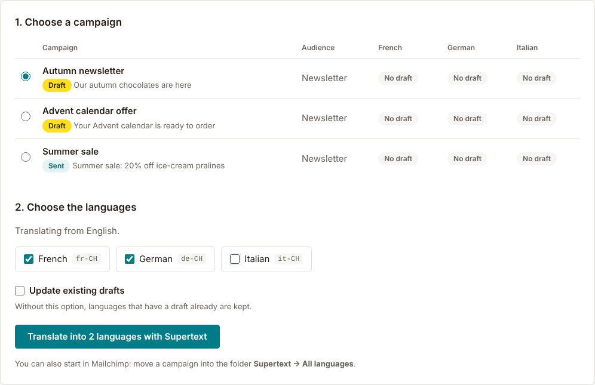
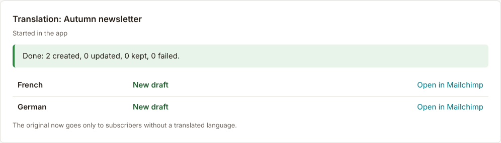
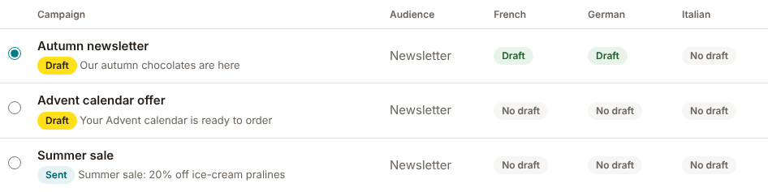
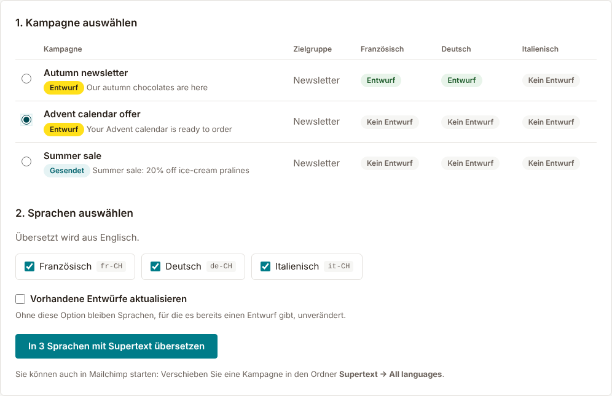
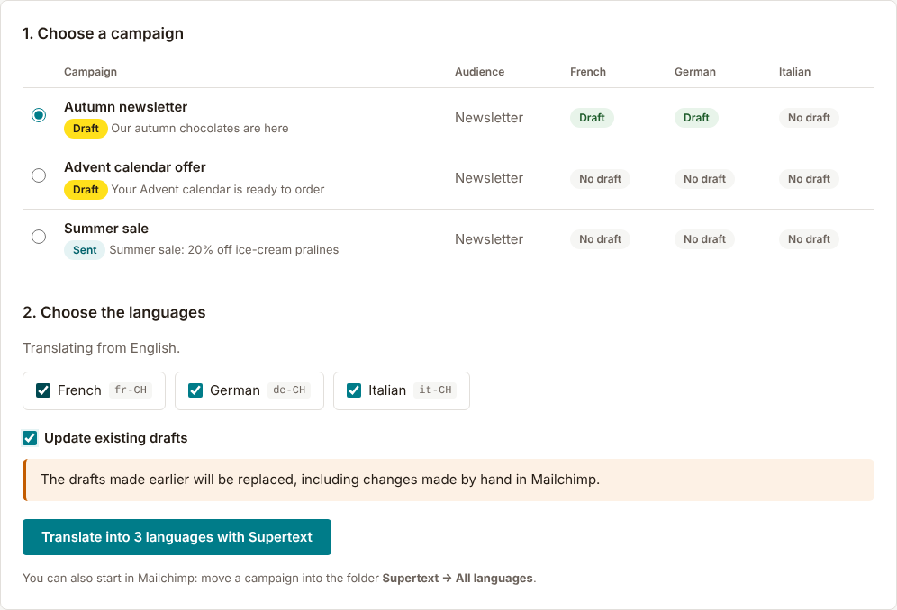

# User guide — Supertext Translation for Mailchimp

For editors. Once the app is set up (see [INSTALLATION.md](INSTALLATION.md)), you turn a finished campaign into one draft per language. The drafts appear in Mailchimp next to the original; you review and send them like any other campaign.

*Screenshots: the app's pages with a sample account (a Swiss chocolate shop that writes its newsletter in English, translated into French, German and Italian for Switzerland).*

## Translate from a Mailchimp folder

1. Write and design the campaign in Mailchimp as usual.
2. In Mailchimp's campaign list, move it into a Supertext folder:
   - **Supertext → All languages** translates into every language set up in the app.
   - **Supertext → German** (French, Italian …) translates into that language only.
3. Within a minute or two the drafts appear, named after the original with the language code, for example *Autumn newsletter · DE*, in the original's folder. The original moves back to the folder it was in.

Moving a campaign into a Supertext folder **again** replaces its drafts with a fresh translation, including changes you made to them by hand. Edit the original and move it again when its text changes; edit a draft only for the last touches.

The app's *Translate* page lists every translation under *Recent translations*, also those started from a folder, with the result per language.

## Translate in the app

1. Open the app and go to **Translate**.
2. Under **Choose a campaign**, pick the campaign. The list shows for each language whether it has a draft already (*Draft*, a link into Mailchimp) or not.
3. Under **Choose the languages**, tick the languages. The code next to each (e.g. `de-CH`) is the variant Supertext translates into.
4. Click **Translate into 2 languages with Supertext**.

   

5. Each language takes a few seconds. The **Translation** box shows the result per language, with a link to each draft in Mailchimp. You can leave the page meanwhile; the translation goes on.

   

The list then shows the drafts:

The app's pages are in English, German, French or Italian; switch at the top right.

## Existing drafts

In the app, languages that have a draft already are **kept** (*Draft exists, kept*). To replace them with a fresh translation, tick **Update existing drafts**. The page warns you first: changes made by hand in Mailchimp are lost.

A draft that was sent already is never changed: the next translation makes a new draft.

## Who gets which version

- Each draft goes to the original's audience, **limited to the subscribers with that language** (Mailchimp's *Language* condition). If the original already had a segment with "all of these" conditions, the language is added to them; otherwise the draft goes to everyone with that language, and the result says so.
- The original goes, if your administrator left that setting on, only to the subscribers **without** a translated language, so nobody receives two versions. Subscribers whose language Mailchimp doesn't know get the original.

Check the recipients in each draft before sending; you can change them in Mailchimp like for any campaign.

## Review and send

Open the draft in Mailchimp (the *Open in Mailchimp* link, or the campaign list), check subject line, preview text and content, send a test email and send or schedule it. Drafts made from a template stay editable in Mailchimp's editor. If Mailchimp didn't accept the template's sections, the result says *Saved as HTML*: you then edit that draft with Mailchimp's code editor.

## What is translated

| | |
| --- | --- |
| Translated | Subject line, preview text, the email's text (headings, paragraphs, lists, buttons, footer text), image alt texts and link titles. Bold, italics and links stay where they are; each paragraph is translated as a whole. |
| Kept as it is | Merge tags such as `*|FNAME|*`, `*|UNSUB|*` or `*|IF:…|*` (put back exactly), links and their addresses, images, styles, layout, the campaign title (it gets the language code), sender name and reply-to address |
| Not translated | Parts of a template outside its editable sections, text marked `translate="no"` or with the class `notranslate`, plain-text versions (Mailchimp generates them from the translated HTML), A/B tests and RSS campaigns |

Plain-text campaigns are translated too. The app never changes the original's content.

## When something goes wrong

The result shows the reason for each language that fails; the other languages still run. Authentication and limit problems stop the whole translation.

| Message | What to do |
| --- | --- |
| *Add your Supertext API key* | An administrator needs to enter the API key under Settings. |
| *Authentication failed* | The API key is no longer valid; tell your administrator. |
| *Supertext doesn't translate into …* | The language needs a Supertext code with a region; an administrator sets it under Settings → Languages. |
| *Supertext returned 2 of 3 merge tags; nothing was saved for this language.* | A merge tag got lost in the translation, so no draft was saved (a lost `*|FNAME|*` would show to subscribers). Translate that language again. |
| *This campaign is a translation made by Supertext* | Translate the original instead. |
| *Mailchimp returned no content for this campaign* | The campaign was probably made with Mailchimp's new email builder; see the installation guide. |
| *Too many requests* | Wait a moment and start again. Languages already done are kept. |
| *Your Supertext translation limit is exceeded* | Your Supertext plan's volume is used up; tell your administrator. |
| *Your session has expired* | Connect Mailchimp again on the app's start page. |
